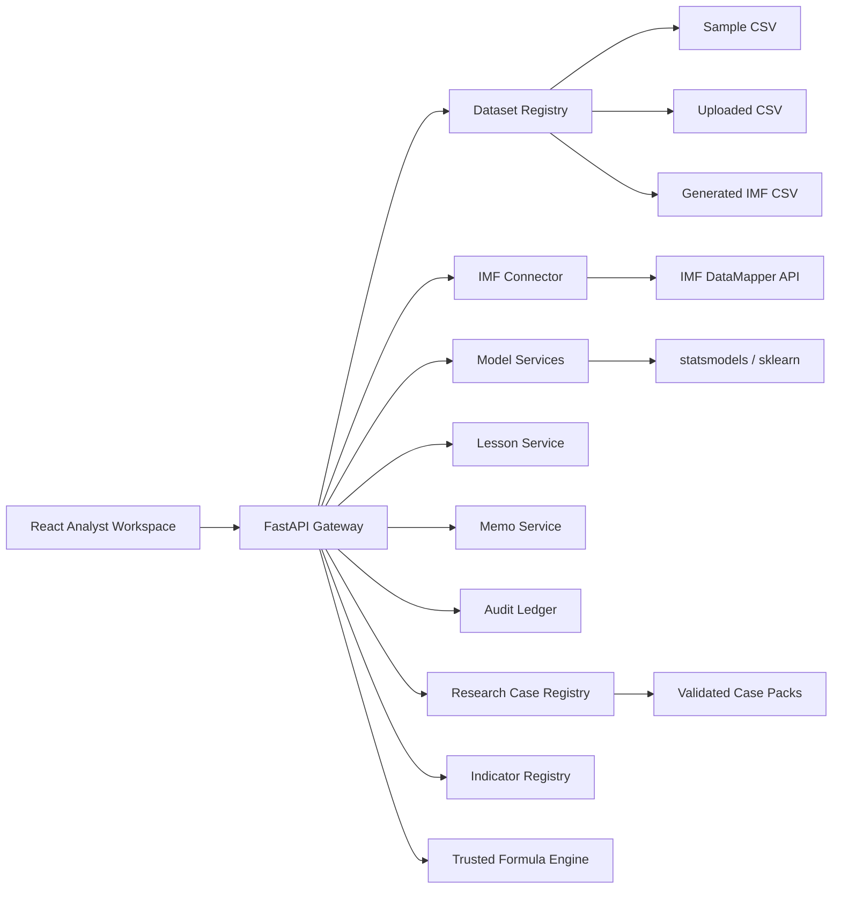

# Risk Research Lab Architecture

## Scope

Risk Research Lab is an educational country-risk and market-risk research platform with a React frontend and FastAPI backend. Country Risk remains the macro/statistical workspace, while Research Cases, the Indicator Registry, Formula Playground, and Historical Event Lab provide a shared evidence-to-decision workflow.

The detailed extension audit, Case Pack schema, provenance rules, and milestone evidence are maintained in [risk-research-lab-architecture.md](risk-research-lab-architecture.md).

## Logical Components

## Production Control Points

- Environment-driven settings live in `backend/app/config/settings.py`.
- Optional API key authentication is enforced when `API_AUTH_REQUIRED=true`.
- Authentication can run in `api_key`, `jwt`, `oidc_jwks`, or `api_key_or_jwt` mode. JWT mode validates HS256 gateway-signed bearer tokens; OIDC/JWKS mode validates RS256 tokens from a bank identity provider or API gateway.
- RBAC enforcement protects sensitive dataset, model, audit, and governance endpoints using roles from validated token claims when API authentication is enabled. Header-based role simulation is restricted to unauthenticated development/test/local environments. API keys authenticate without granting application roles.
- Security headers and request IDs are applied by `backend/app/middleware.py`.
- Audit events are written as JSONL through `backend/app/services/audit_service.py`.
- Audit events include a SHA-256 hash chain for tamper-evidence and can be verified through `/api/audit/verify`.
- Audit events can also be forwarded to an HTTP SIEM or central logging endpoint.
- Model intended-use approval is controlled by `backend/app/config/model_catalog.json`.
- Exceptional model intended uses can be approved through model-risk approval records.
- Readiness checks are exposed through `GET /api/ready`.
- Metrics are exposed through `GET /api/metrics` for internal monitoring.
- Rate limiting can be enabled in service as defense-in-depth behind gateway controls.
- Backup and restore scripts provide a repeatable registry disaster-recovery drill.
- Dataset access is mediated by the registry rather than hard-coded sample paths.
- The dataset registry supports JSON storage for local MVP and SQLite storage for transactional deployment posture.
- Model runs return diagnostics, warnings, Python code preview, strengths, weaknesses, and suggestions.

## Production Boundary

The current live-ready baseline is suitable for controlled internal learning or UAT. Before broad banking production release, the API key control should be replaced or fronted by enterprise SSO/OIDC, the file registry should move to approved durable storage, and audit logs should be shipped to the enterprise SIEM or immutable log store.
