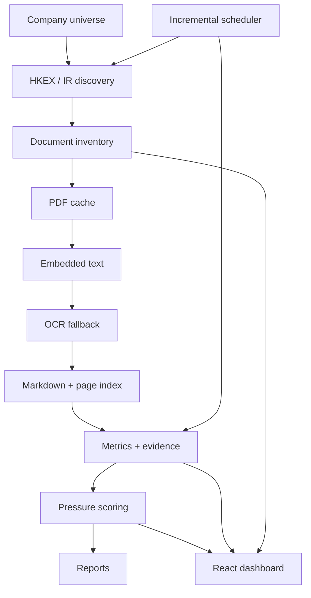

# Architecture

## Purpose and scope

The system transforms official annual-report documents into evidence-backed domestic-demand indicators. Discovery is replaceable; the document inventory is the boundary between web acquisition and deterministic processing.

## Modules

- `scripts/01_*` validates the YAML seed and creates the universe CSV.
- `src/hkex/search.py` resolves issuer IDs from HKEX's active-security catalogue and submits official title-search queries for exactly three canonical reports per issuer. `browser/hkex_download_playwright.ts` is the interactive fallback. `src/hkex/downloader.py` downloads gently and caches. Browser-use is an optional wrapper; Firecrawl captures auditable page Markdown/HTML; manual CSV is the guaranteed fallback.
- `src/pdf/` extracts embedded text, calculates quality, invokes multilingual Tesseract only below threshold, preserves both versions, emits Markdown page markers, and best-effort tables.
- `src/analysis/` defines Pydantic contracts, conservative label extraction, narrative theme hits, normalized component scores, and industry rollups.
- `data/processed/metric_evidence.*` is the evidence store. Scores consume only wide values generated from evidence records; missing evidence produces null values.
- `src/reporting/` renders deterministic reports. `web/` reads exported static JSON and exposes metrics, citations, sources, explanations, and warnings.
- `src/qa/` and `tests/` enforce data contracts. `state/` and scripts 08–09 support incremental updates and local scheduling.

## Important contracts

`document_inventory.csv` is keyed by deterministic `document_id`; content is de-duplicated by URL and SHA-256. `metric_evidence` is keyed conceptually by stock/year/metric/document and requires `evidence_text + pdf_page` or `missing_reason`. `source_page_index` is one row per extracted page. Scores remain within 0–5 and include component details plus coverage confidence.

Raw PDFs and state history are preservation zones. Configuration and source code are editable; generated processed files should be regenerated through scripts. Extension points include issuer-IR adapters, richer table alignment, interim reports, and cached LLM candidate extraction that is never trusted until grounded.

<!-- generated:start -->
## Generated repository inventory

Refreshed: `2026-07-11T23:35:55.885725+00:00`

- Scripts: 01_build_universe.py, 02_hkex_search_download.py, 03_pdf_to_markdown.py, 04_extract_metrics.py, 05_score_domestic_demand.py, 06_generate_report.py, 07_run_all.py, 08_incremental_update.py, 09_schedule_weekly.py, 10_generate_architecture_docs.py, 11_production_audit.py
- Config: extraction_schema.yaml, industry_taxonomy.yaml, manual_report_links.csv, scoring_weights.yaml, universe_seed.yaml, update_policy.yaml
- Processed data present: company_universe.csv, company_year_metrics.csv, company_year_metrics.json, demand_pressure_scores.csv, demand_pressure_scores.json, document_inventory.csv, extraction_quality_log.csv, incremental_update_log.csv, industry_summary.csv, industry_summary.json, metric_evidence.csv, metric_evidence.jsonl, production_audit.json, source_documents.csv, source_page_index.csv, unsupported_or_missing_metrics.csv
- Web exports present: company_universe.json, company_year_metrics.json, demand_pressure_scores.json, document_inventory.json, industry_summary.json, latest_run.json, metric_evidence.json, quality_warnings.json, source_documents.json, source_page_index.json
<!-- generated:end -->
